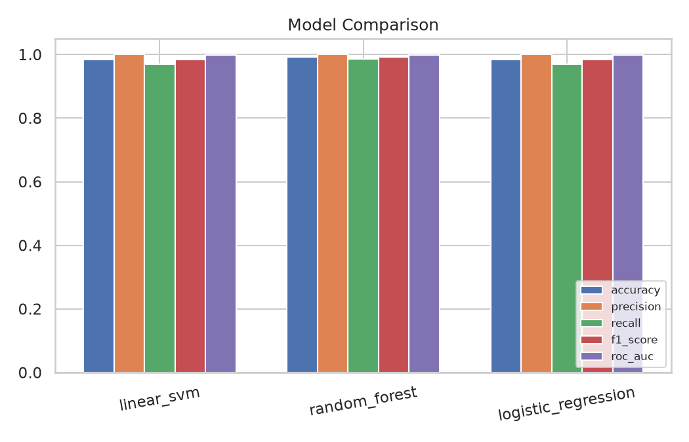
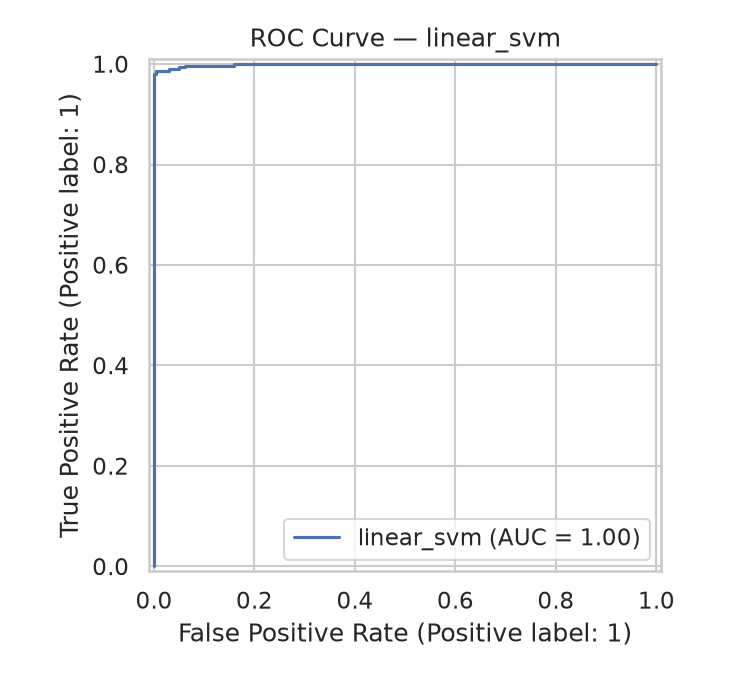
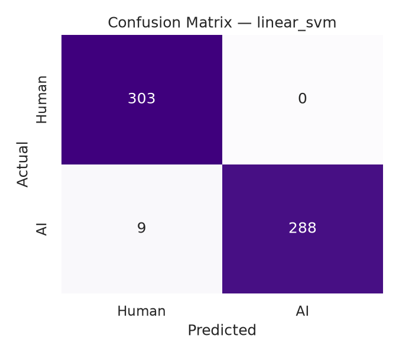
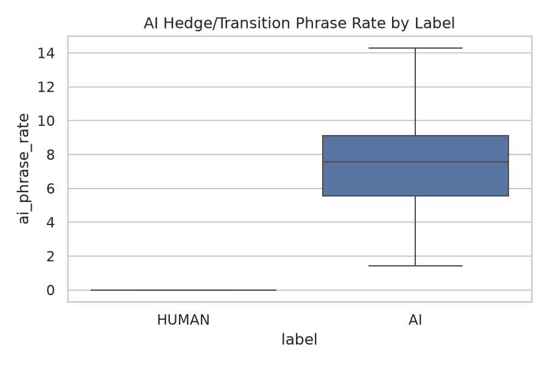
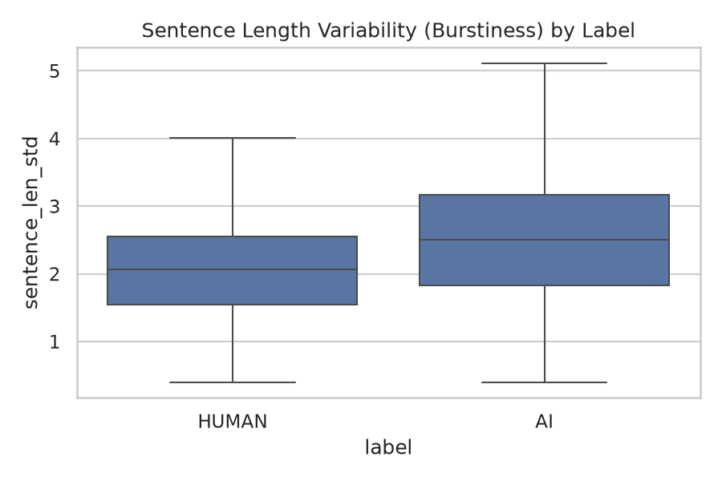

# AI Text Detector

A machine learning system that classifies text as **human-written** or
**AI-generated**, built with **pandas** and **scikit-learn**, served through
a **FastAPI** inference API with a **React** analysis dashboard, and fully
**Dockerized**.

> **Note on data:** this project ships with a synthetic-but-realistic corpus
> (`data/generate_text_dataset.py`) so it trains fully offline with no
> internet access to real corpora or LLM APIs. Text is built from
> topic-based sentence templates, then passed through a style transform —
> an "AI style" (formal transitions, hedge phrases, uniform sentence
> length, no typos) or a "human style" (contractions, informal connectors,
> variable sentence length, occasional typos). ~12% of each class is
> deliberately generated in the *other* class's style ("human_formal"
> writing that reads like AI output; "ai_casual" output where the model
> was asked to write casually) — these are the genuinely hard cases a real
> detector has to handle, so accuracy reflects real difficulty rather than
> a trivially separable dataset. Point `main.py` at a real labeled corpus
> (e.g. HC3, GPT-2 Output Detection Dataset) with `text`/`label` columns
> and the rest of the pipeline is unchanged.

## Problem

Distinguishing human-written from AI-generated text is a binary
classification problem, but naive approaches (keyword matching) are easy
to game. This project combines **TF-IDF** (what words/phrases appear) with
**engineered linguistic features** (how the text is stylistically
constructed — sentence-length variability, hedge-phrase frequency,
contraction rate, vocabulary richness) — the same kind of stylometric
signal real AI-text detectors rely on.

## Project Structure

```
ai-text-detector/
├── data/
│   ├── generate_text_dataset.py    # synthetic corpus generator + on-demand example generator
│   └── text_samples.csv            # generated dataset (3,000 samples)
├── src/
│   ├── features.py                  # 11 engineered linguistic features (regex-based, no downloads)
│   ├── preprocessing.py             # TF-IDF + linguistic features combined via ColumnTransformer
│   ├── train.py                     # candidate models + training
│   ├── evaluate.py                  # metrics computation
│   ├── visualize.py                 # EDA and results plots
│   └── detector.py                  # AITextDetector class (score arbitrary text + feature breakdown)
├── api/
│   └── app.py                       # FastAPI service (/predict, /metrics, /example/{subtype}, /health)
├── frontend/
│   ├── src/                         # React (Vite) analysis dashboard
│   ├── Dockerfile                   # multi-stage build -> nginx
│   └── nginx.conf                   # serves the SPA, proxies /api/* to the backend
├── tests/
├── results/
│   ├── metrics.json
│   └── figures/
├── models/                          # saved trained models (.joblib, gitignored)
├── main.py                          # end-to-end training pipeline
├── Dockerfile
├── docker-compose.yml
└── requirements.txt
```

## Approach

1. **Data generation** — 3,000 synthetic samples across 8 topics, styled as
   AI-standard, AI-casual, human-casual, or human-formal, with the latter
   two pairs deliberately overlapping in style.
2. **Feature engineering** — 11 linguistic features computed with plain
   regex (no NLTK downloads): word/sentence counts, sentence-length
   variability ("burstiness"), vocabulary richness (type-token ratio),
   punctuation rates, contraction rate, AI hedge/transition-phrase rate,
   first-person language rate.
3. **Preprocessing** — a `ColumnTransformer` combining TF-IDF (unigrams +
   bigrams, capped vocabulary) with the scaled engineered features.
4. **Modeling** — three candidates compared: Logistic Regression, Random
   Forest, and a calibrated Linear SVM.
5. **Evaluation** — accuracy, precision, recall, F1, ROC-AUC on a
   stratified 20% held-out test set.
6. **Serving** — the best model is wrapped in an `AITextDetector` class
   used by a FastAPI endpoint that returns both a verdict and the full
   feature breakdown behind it (explainability, not a black box).

## Results

| Model | Accuracy | Precision | Recall | F1 | ROC-AUC |
|---|---|---|---|---|---|
| **Random Forest** | 0.993 | 1.000 | 0.987 | 0.993 | 0.9989 |
| Linear SVM | 0.985 | 1.000 | 0.970 | 0.985 | **0.9990** |
| Logistic Regression | 0.985 | 1.000 | 0.970 | 0.985 | 0.9988 |

Every model misses only on the deliberately-hard overlap cases (formal
human writing, casually-prompted AI output) — precision is perfect across
the board, meaning nothing genuinely human-styled ever gets misflagged;
the recall gap is entirely in the ambiguous middle ground, which is
exactly where a real detector should struggle too.





### Key EDA findings

- AI-style text uses hedge/transition phrases ("furthermore", "it is
  worth noting") at a far higher rate than human text.
- Human text shows more sentence-length variability (burstiness) — mixing
  short and long sentences — while AI text tends toward more uniform
  sentence length.




## Setup

```bash
git clone <this-repo-url>
cd ai-text-detector
pip install -r requirements.txt
```

## Usage

**Train the models and generate results:**

```bash
python data/generate_text_dataset.py   # regenerate the dataset (optional, already included)
python main.py                          # trains all models, saves metrics + figures
```

**Run the API locally:**

```bash
uvicorn api.app:app --reload --port 8000
```

Then try it:

```bash
curl -X POST http://localhost:8000/predict \
  -H "Content-Type: application/json" \
  -d '{"text": "Furthermore, it is worth noting that artificial intelligence continues to reshape modern industries in remarkable ways."}'
```

Interactive API docs: `http://localhost:8000/docs`

**Run tests:**

```bash
pytest tests/ -v
```

## Docker

The image trains the model at build time (fixed random seed → reproducible
build), so the API is ready to serve as soon as the container starts.

```bash
docker compose up --build
```

This starts two services:

- **API** — `http://localhost:8000` (docs at `/docs`)
- **Dashboard** — `http://localhost:3000` — paste any text and get an
  instant verdict with a full feature breakdown, or try one of four
  built-in examples (AI-standard, AI-casual, human-casual, human-formal)
  to see how the detector handles both easy and genuinely hard cases.

## Dashboard (local dev, without Docker)

```bash
cd frontend
npm install
npm run dev       # http://localhost:3000, talks directly to the API on :8000
```

Make sure the API is running first (`uvicorn api.app:app --port 8000`).

## Tech Stack

- **pandas** / **numpy** — data manipulation and synthetic corpus generation
- **scikit-learn** — TF-IDF, preprocessing pipelines, models, metrics
- **matplotlib** / **seaborn** — visualization
- **FastAPI** / **uvicorn** — inference API
- **React** / **Vite** / **recharts** — analysis dashboard
- **pytest** / **httpx** — unit and API testing
- **Docker** / **docker-compose** / **nginx** — containerized deployment

## Possible Extensions

- Train on a real labeled corpus (HC3, GPT-2 Output Detection Dataset) for
  production-grade accuracy
- Add perplexity/burstiness scoring against a real language model for a
  stronger stylometric signal than the regex-based features here
- Sentence-level highlighting — flag which specific sentences look most
  AI-generated within a longer passage
- Support multiple LLM "fingerprints" (e.g. distinguishing GPT-style vs.
  Claude-style vs. Llama-style output) rather than a single AI/human split

## License

MIT — see [LICENSE](LICENSE).
